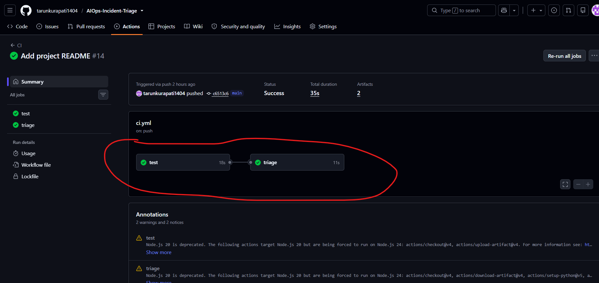
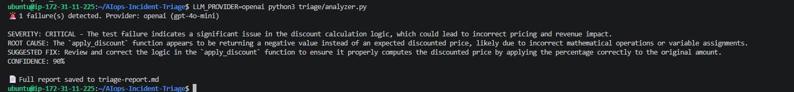

# 🚨 AI-Powered Incident Triage Bot

An AIOps pipeline that **detects CI failures, diagnoses them with an LLM, and pages the on-call engineer** — automatically, on every push.


## 🏗️ How It Works

```text
git push
│
▼
┌─────────────────────────┐
│  GitHub Actions (CI)    │
│  1. Build Docker image  │
│  2. Run tests in cont.  │──▶ tests fail (intentional bug)
│  3. Upload JUnit XML    │
└───────────┬─────────────┘
            │
            ▼
┌─────────────────────────┐
│  Triage job             │
│  4. Download failure XML│
│  5. LLM analyzes it     │──▶ Ollama (local, free) or OpenAI
│  6. Email report sent   │
└─────────────────────────┘
```

## ✨ Features

- **Containerized CI** — tests run inside Docker on every push; identical environment everywhere.
- **LLM-powered triage** — severity, root cause, and suggested fix generated automatically.
- **Dual LLM providers** — local Ollama (free, default) ⇄ OpenAI, switched effortlessly via one environment variable.
- **Automatic paging** — triage report emailed directly to the on-call engineer via SMTP.
- **Cloud-deployed** — the full pipeline reproduced and running on AWS EC2.

## 🛠️ Tech Stack

`Python` · `pytest` · `Docker` · `GitHub Actions` · `Ollama` / `OpenAI API` · `AWS EC2` · `SMTP`

## 🚀 Quickstart

### 1. Run locally (free, offline LLM)

```bash
git clone https://github.com/tarunkurapati1404/AIops-Incident-Triage.git
cd AIops-Incident-Triage

python3 -m venv .venv && source .venv/bin/activate
pip install -r requirements-dev.txt

pytest                                    # 1 failed (intentional), 1 passed
python triage/analyzer.py                 # LLM triage via local Ollama
```

### 2. Run with Docker

```bash
docker build -t aiops-incident-triage .
docker run aiops-incident-triage          # tests run inside the container
```

### 3. Use OpenAI instead of local Ollama

```bash
export LLM_PROVIDER=openai
export OPENAI_API_KEY='sk-...'
python triage/analyzer.py
```

> ⚠️ **Note:** The failing test is intentional — it simulates a production incident so the bot has something to triage. Fixing it is left as an exercise! 😉

## 📸 Demo

| CI Pipeline (Test + Triage Jobs) | AI Triage Report |
| :---: | :---: |
|  |  |

## 📁 Project Structure

```text
├── app/main.py            # sample app (intentional bug inside)
├── tests/test_main.py     # pytest suite
├── triage/analyzer.py     # LLM triage engine (Ollama/OpenAI)
├── triage/notify.py       # email pager
├── .github/workflows/ci.yml
├── Dockerfile
└── pytest.ini             # JUnit XML output config
```

## 🔮 Future Improvements

- Feed failing source code into the prompt for sharper, context-aware diagnoses.
- Add native Slack/Microsoft Teams webhook notification support.
- Write a Terraform module for automated AWS infrastructure provisioning.
- Implement self-healing: automatically open a GitHub Issue populated with the triage report.